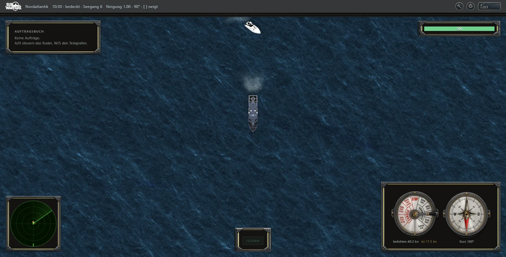
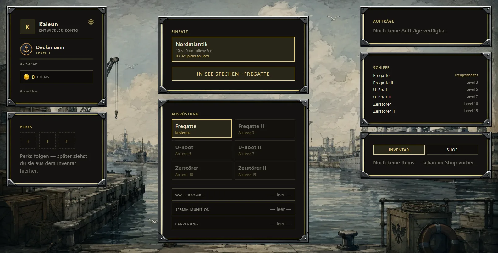
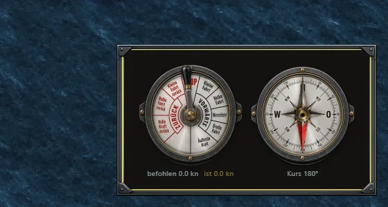
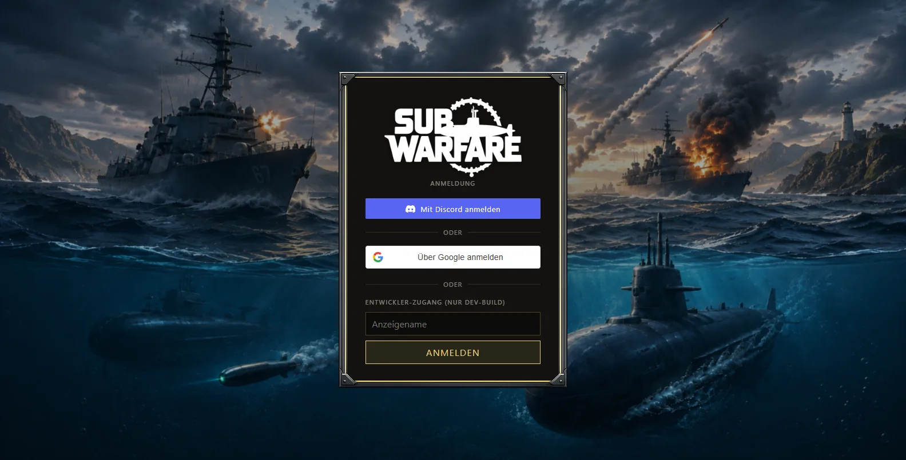
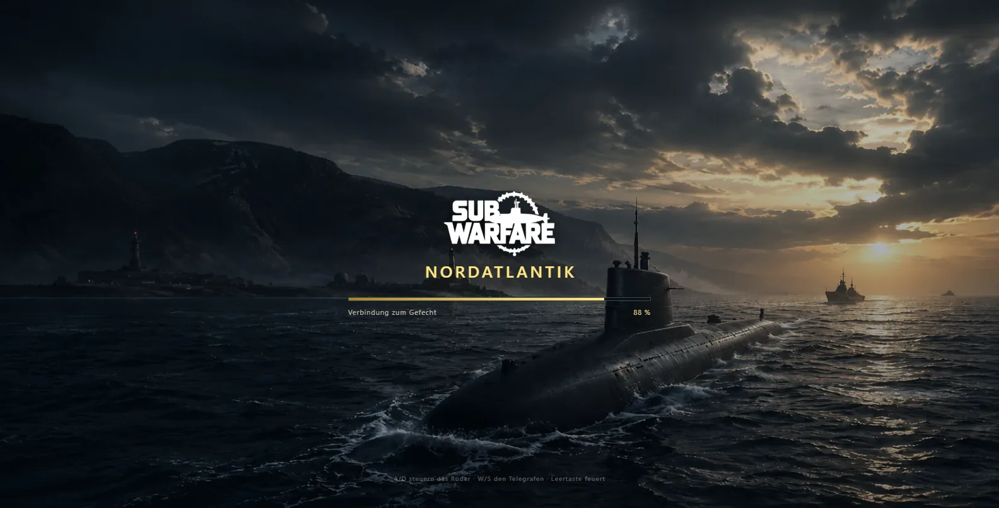

# Sub Warfare

**Extraction-Shooter zur See, direkt im Browser.** Schiff ausrüsten, in den
Nordatlantik stechen, Beute machen — und lebend wieder rauskommen. Wer sinkt
oder das Gefecht abbricht, verliert Fracht und geladene Munition; nur wer eine
Extraktionszone erreicht und acht Sekunden hält, nimmt alles mit nach Hause.

Sub Warfare ist die Neuauflage von **Silent Wolves (2009)** mit heutiger
Technik: Vue 3 + PixiJS 8 im Browser, ein server-autoritativer
Node.js-Simulationskern, socket.io dazwischen.



---

## Spielprinzip: die Sortie

1. **Hafen** — Schiff wählen (Level-Freischaltung), Waffenslots aus dem eigenen
   Inventar bestücken: Torpedos, 125-mm-Munition, Wasserbomben, Täuschkörper,
   Panzerung. Munition gibt es in MK-Stufen mit steigendem Schaden.
2. **In See stechen** — der Einsatz kostet die Schiffsgebühr, die geladene
   Munition wird dem Lager entnommen. Beides steckt ab jetzt im Einsatz.
3. **Gefecht** — auf der offenen Karte fahren Spieler und NPC-Verkehr
   (Tanker, Jachten, Schnellboote). Versenkte Schiffe hinterlassen
   **Lootkisten**: NPCs nach Beutetabelle, Spieler verlieren Schiffsgebühr und
   getragene Fracht. Kisten werden durch Überfahren geborgen.
4. **Extraktion** — zwei mit Bojen markierte Zonen. Acht Sekunden
   ununterbrochen im Kreis halten, dann werden Fracht-Coins gutgeschrieben und
   Restmunition zurückgebucht.
5. **Alles andere ist Verlust** — Exit-Knopf, Verbindungsabbruch oder Untergang:
   Fracht und geladene Ausrüstung sind weg. Die Schiffsgebühr fällt beim ersten
   Untergang einer Sortie als Kiste ins Wasser — wer das Wrack plündert,
   übernimmt sie.



## Features

**Gefecht**
- **Vier Waffensysteme:** Torpedos (Rohre laden, scharfschalten, Salvenfächer),
  125-mm-Geschütz mit Mauszielen, Wasserbomben gegen getauchte Boote,
  Täuschkörper mit Annäherungszündung gegen Torpedos.
- **U-Boote tauchen** (5-Sekunden-Übergang) und fahren unter Überwasserschiffen
  hindurch; Periskop hebt die Sicht, schwere Schäden erzwingen das Auftauchen.
- **Panzerung** (MK 1–5) schluckt einen Prozentsatz jedes Treffers und verliert
  dabei Integrität — je nach Waffe unterschiedlich schnell.
- **Rammschaden:** überlappende Rümpfe verlieren 10 % ihrer maximalen HP je
  Sekunde, Panzerung reibt sich mit 10 Punkten je Sekunde auf. Getauchte Boote
  kollidieren nicht mit der Oberfläche.
- **Schadensmodell:** Rauchstufen für alle sichtbar, Drossel auf halbe Fahrt
  unter 20 % HP, Kill-Zuschreibung bis in den Ereignislog.
- **Wetter und Seegang** sind Karten-Zustand vom Server: Seegang streut die
  Schüsse und dämpft das Sonar.

**Welt und Sicht**
- Server-seitiges **Interest Management**: man bekommt nur, was das eigene
  Sonar hergibt — fremde Wegpunkte bleiben geheim.
- **Sichtkreis** mit Verdunkelung, Periskop-Kegel, PPI-Sonar mit Nachleuchten.
- **Foxhole-artiges Umschauen** mit gehaltener rechter Maustaste.
- NPC-**Bots** beleben die Karte; zwei Bots zermahlen sich beim Zusammenstoß
  bewusst nicht — Loot entsteht nur mit Spielerzutun.

**Cockpit**
- **Maschinentelegraf als echtes Instrument:** Blatt mit neun Rasten, der Hebel
  schwenkt auf die befohlene Stufe (W/S, Mausrad, Klick auf den Sektor).
  Daneben ein **Kompass** mit drehender Nadel.
- **Ereignislog** (Welt/Lokal/Event) mit alternden, selbst ausblendenden
  Zeilen; Auftragsbuch, Munitionsleiste mit Rohranzeige, Rumpf- und
  Panzerungsleiste.



**Konto und Ökonomie**
- Login über **Discord** oder **Google**, Dev-Login im Entwicklungs-Build;
  Konten lassen sich nachträglich verknüpfen.
- **Coins, Inventar, Shop, Perk-Slots**, Levelsystem mit
  Schiffs-Freischaltungen — alles in MariaDB, Kataloge (Schiffe, Panzerung,
  Munition) kommen aus der Datenbank.



## Architektur

pnpm-Monorepo aus drei Anwendungen und einem gemeinsamen Paket:

| Paket | Rolle |
| --- | --- |
| `@subwarfare/client` | Browser-Client: Vue 3 + Vite + vue-router, Rendering über PixiJS 8 (WebGL) |
| `@subwarfare/api` | Fastify: Auth (Discord/Google/Dev, JWT), Accounts, Inventar, Shop, Lobby-Queue, interne Katalog-Endpunkte |
| `@subwarfare/game-server` | Autoritativer Simulationsserver, socket.io, 20 Ticks/s — bewusst **ohne Datenbank** |
| `@subwarfare/shared` | Fahrmodell, Kampf-/Beute-Regeln, Typen und das Netzwerkprotokoll für beide Seiten |

Grundprinzipien:

- **Der Server ist die einzige Quelle der Wahrheit.** Der Client schickt nur
  Absichten (Wegpunkt, Telegrafenstufe, Feuerbefehl); Position, Treffer und
  Schaden rechnet ausschließlich der Game-Server. Distanz-, Besitz- und
  Rechteprüfungen laufen server-seitig.
- **Ein Protokoll, eine Definition.** Alle Ereignistypen liegen in
  `@subwarfare/shared`; inkompatible Änderungen zählen die `PROTOCOL_VERSION`
  hoch (aktuell 15) — alte Clients passen dann schlicht nicht mehr.
- **Tickets statt Sessions im Gefecht:** die API stellt einen signierten
  Einmal-Beitrittsschein aus (JWT, jti-Einmalgebrauch, kurze Lebensdauer), der
  Schiff, Panzerung und geladene Munition trägt. Der Game-Server prüft nur die
  Signatur — er braucht keine Datenbank, Kataloge holt er sich beim Start über
  interne API-Endpunkte.
- **Abrechnung an den Rändern:** Munition wird bei Ticketausstellung
  abgebucht („Lieferschein") und nur bei erfolgreicher Extraktion
  zurückgebucht; Coins schreibt die API auf Meldung des Game-Servers gut.
- **Maps sind Daten, kein Code** — deklarative Definition aus Größe,
  Spawn- und Extraktionspunkten plus Wetterlage.

Simulation: fester Zeitschritt (20 Hz) mit Akkumulator, Broadcast 20 Hz als
volatile Snapshots, Client-seitige **Snapshot-Interpolation** (~125 ms) mit
Frame-Crossfade der 64-Richtungs-Billboards. Das Fahrmodell in `shared/sim/`
ist eine reine Funktion über flache Daten — Client und Server fahren
denselben Code.

## Rendering in Kürze

- Die Welt wird „schräg von oben" gezeigt: eine **einzige affine Matrix**
  staucht vertikal (kein Drehanteil). Maßstab überall gleich, Maus→Welt exakt
  umkehrbar.
- Schiffe sind **64-Richtungs-Billboards** aus vorgerenderten Atlanten;
  Requisiten (Lootkisten, Bojen) kommen mit 8 Richtungen aus.
- Das **Wasser** ist ein prozeduraler Shader in Weltkoordinaten — Dünung und
  Windwellen in Metern, Seegang und Tageszeit vom Server.
- Das **HUD ist DOM/Vue**, nicht Canvas: Panels fangen Maus und Rad von selbst
  ab, der Pixi-Ticker schreibt einen HUD-Snapshot und weckt Vue gedrosselt.



## Entwicklung

Voraussetzungen: **Node.js ≥ 20** (entwickelt mit 24) und **pnpm**.

```bash
pnpm install
pnpm dev
```

Startet parallel:

| Prozess | Adresse |
| --- | --- |
| Client (Vite) | http://localhost:5173 |
| API (Fastify + `/lobby`-Socket) | http://localhost:8090 — Pfad `/api`, Socket `/api/socket.io` |
| Game-Server (socket.io) | http://localhost:8080 — Socket `/game/socket.io` |

Lokal läuft alles **ohne Konfiguration**: Dev-Login ist aktiv, Accounts liegen
im Speicher, die Kataloge kommen aus eingebauten Standardwerten. Secrets
(`JWT_SECRET`, OAuth-Client-IDs, `DATABASE_URL`) liegen ausschließlich in
env-Dateien außerhalb des Repos.

```bash
pnpm build       # shared -> game-server -> api -> client
pnpm typecheck   # Typprüfung über alle Pakete
pnpm clean       # dist/-Verzeichnisse entfernen
```

Im Dev-Build liegt das laufende Spiel unter `window.__game` für die
Browser-Konsole; ein Entwicklermenü (Rolle im Ticket) kann Schiffsmodell,
Wetter und Testkisten setzen.

## Deployment

Ein VPS, ein Push:

```bash
git push hetzner main
```

Ein Bare-Repo mit `post-receive`-Hook baut das Monorepo, führt die
Datenbank-Migrationen aus und startet die systemd-Dienste (`subwarfare-api`,
`subwarfare-game`) neu. Davor: **Caddy** mit Auto-HTTPS als eine Origin —
Client-`dist` als Dateiserver, `/api/*` und `/game/*` als Reverse-Proxys.
MariaDB läuft auf derselben Maschine. Die Dev-Instanz ist unter
**dev.subwarfare.com** erreichbar (derzeit zugangsbeschränkt);
`subwarfare.com` wird später Website, Auth und Serverwahl übernehmen und an
die Spielserver weiterreichen.

## Karte `ocean01` — „Nordatlantik"

25.000 × 25.000 Units offenes Wasser als **Endlos-Karte** (Torus: wer über
eine Kante fährt, kommt nahtlos auf der Gegenseite herein), Wetterlage
„Nordatlantik" (bedeckt, rau); weitere Presets: klarer Tag, Sturm,
Dämmerung, Nacht.

| Typ | ID | Position | Sonstiges |
| --- | --- | --- | --- |
| Spawn | `spawn-north` | 12.500 / 2.500 | Rotation 180° |
| Spawn | `spawn-south` | 12.500 / 22.500 | Rotation 0° |
| Extraktion | `exit-nw` | 6.250 / 6.250 | Radius 400, 6 Bojen |
| Extraktion | `exit-se` | 18.750 / 18.750 | Radius 400, 6 Bojen |

Die Zonen liegen diagonal versetzt im offenen Wasser: wer raus will, muss
eine Fahrt quer über die Karte riskieren.

Auf der Gegendiagonale verläuft die **Frachtroute** (auf der Minimap als
gestrichelte Linie): eine sanfte S-Kurve von oben rechts nach unten links,
auf dem Torus über die Kartenecke zur Schleife geschlossen. 14 Frachter
(`tanker01`, 7 je Richtung) verkehren darauf unregelmäßig auf getrennten
Spuren; ein versenkter Frachter läuft nach 5 Minuten am Routeneinstieg
seiner Richtung wieder ein. Frachter spawnen ausschließlich über diese
Route — der übrige Zufallsverkehr fährt keine Tanker.

## Vorbild

Sub Warfare ist die Neuauflage von **Silent Wolves** (Browsergame, 2009) —
gleiche Seele, heutige Technik. Mechaniken wie Heimathafen, Missionen und
Flotten aus dem Vorbild stehen auf der Karte für später.
